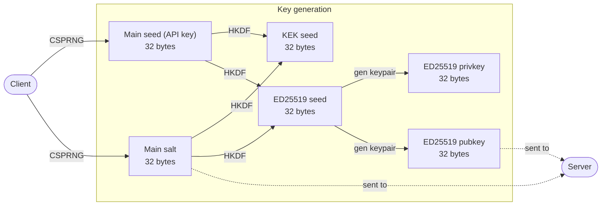
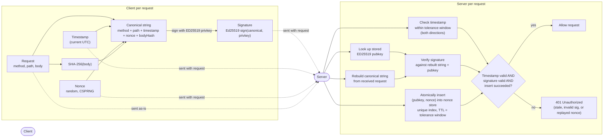
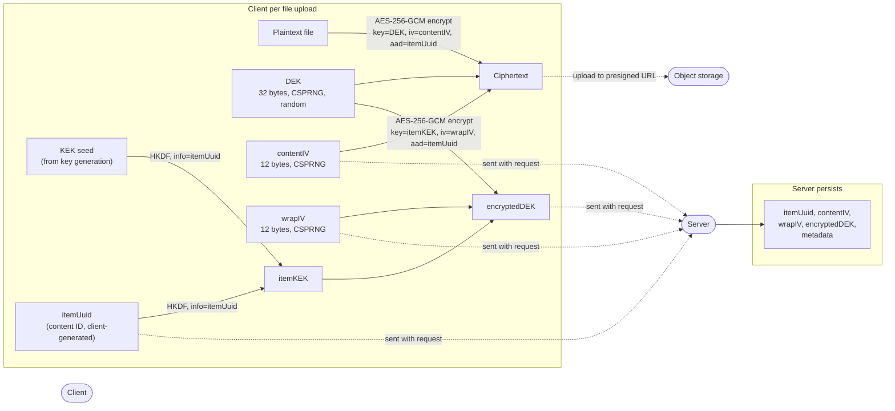
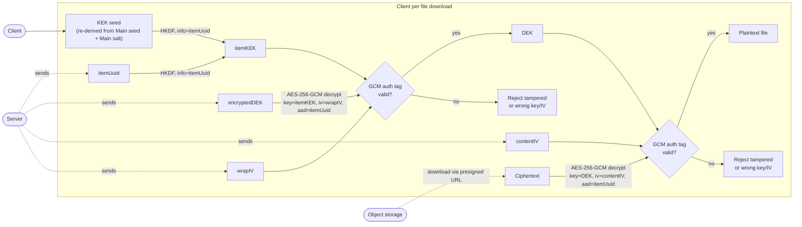

# Fix-up: Closing the API-key-transmission gap in envelope encryption to resolve the server compromise risk


Addendum to [`v1`](v1.md).

## Summary

The v1 design derives the KEK from the API key, which is correct in principle, but the API key still has to reach the server on every authenticated request for the server to verify who's calling. That means the server sees the raw API key in transit, every time. Since the server also knows the per-user salt and KDF parameters, it can derive the same KEK itself. Server-side encryption can then unwrap any DEK and read any user's data, silently, without ever persisting a key. This lands the system back in exactly the failure mode v1's own **"Server-managed encryption key"** section warns against: *"the server always has access to decryption keys"*, just without a key table to point to.

This gap isn't visible in v1's **Limitations** section as written. *"No protection against active server compromise: keys exist in memory during requests"* undersells it it's not just that keys exist in memory, it's that the server can derive the KEK for **any** user on **every single request**, trivially, using data it already has. That's a much larger exposure than transient in-memory presence implies.

The fix is to stop sending the API key to the server at all, past the point where the client first derives keys from it. Authentication and encryption both still come from the same single secret the user holds, but they take different exits from it, and neither exit requires handing the secret to the server.

## The core upgrade: separate authentication from encryption, derived from one secret

The API key the user holds does two jobs: prove who they are, and seed the encryption key. Currently both jobs require sending the key (or something equivalent to it) over the wire. Only one of those jobs actually needs to.

**Authentication** can be done with a challenge-response signature instead of presenting a secret:

1. Client generates an Ed25519 keypair locally, derived from the API key. The private key never leaves the client, not even at registration.
2. Client registers only the **public key** with the server.
3. On every request, the client signs the request (method, path, timestamp, nonce, body hash) with the private key. The server verifies against the stored public key.
4. A random, client-generated nonce recorded server-side in a `(pubkey, nonce)`-unique store with a TTL matching the timestamp tolerance window prevents replay of a captured signed request. The server attempts an atomic insert of `(pubkey, nonce)`; a duplicate-key failure means the nonce was already used and the request is rejected. This design tolerates legitimately parallel requests from the same client (unlike a strictly increasing counter, which rejects out-of-order concurrent requests as false positives) at the cost of a small per-request write and scheduled cleanup of expired entries.

The server now authenticates every request without ever seeing anything that could reconstruct the private key or the KEK. A full storage **and** traffic compromise reveals only public keys and signatures, and neither is reversible into the API key.

**Encryption** stays exactly as designed in v1: KEK via KDF, DEK wraps the data, salts stored server-side, except the KEK is now derived purely client-side and never crosses into a request at all. The server's role in the encryption flow is unchanged: it stores ciphertext, wrapped DEK, salt, and IV, and hands them back on retrieval. It was already correctly excluded from this path; the fix is making sure authentication doesn't reintroduce it.

## Domain-separated derivation

Since the signing key and the KEK now come from the same API key, they must be derived independently so that neither derivation can be used to reconstruct the other:

```
signingSeed = HKDF(apiKey, userSalt, info="signing-v1", 32 bytes)
kekSeed     = HKDF(apiKey, userSalt, info="kek-v1",     32 bytes)

ed25519KeyPair = Ed25519.fromSeed(signingSeed)
itemKEK        = HKDF(kekSeed, <fixed-or-empty-salt>, info="kek-item-v1:" + itemUuid, 32 bytes)
// itemUuid is the item's own content ID already stored as the record's primary
// identifier, so no separate per-item salt needs to be generated, transmitted, or
// persisted. HKDF is used here (not Argon2id/PBKDF2) because kekSeed is already
// high-entropy, CSPRNG-derived material not a human password so the slow/
// memory-hard properties of a password-hardening KDF aren't defending against
// anything real at this step. The same itemUuid also serves as the AAD on both
// AEAD operations for this item (see "AAD-bound AEAD operations" below) these
// are two independent roles for the same value, not a cryptographic dependency
// between them.
```

The `info` label is what cryptographically separates the two outputs from one input. This also gives clean versioning if either derivation ever needs to change (`kek-v2`) without disturbing the other.

One secret for the user, two independent keys internally. No additional secret to generate, store, or back up on the client beyond what the design already required.

## Key generation must happen client-side, not server-side

A tempting shortcut is to have the server generate the API key and derive/store the public key itself, then hand the key to the client. This should be avoided: it requires the server to hold the private key material, even momentarily, to compute the public key before sending the secret away. That window is a real exposure - crash dumps, swap, logging middleware, or APM tracing can all capture process memory at generation time, and it's a single code path that, if ever compromised, exposes every key generated through it.

The client should generate its own keypair/API key locally (e.g. via `crypto.getRandomValues()` / WebCrypto) and register only the public key. The server never computes, transmits, or transiently holds the private material at any point, including provisioning.

## Updated flow

```
Registration (one-time)
  Client: generate random secret (the "API key")
  Client: derive signingSeed, kekSeed  (HKDF, domain-separated)
  Client: derive Ed25519 keypair from signingSeed
  Client -> Server: register(publicKey)
  Server: store publicKey only

Every request
  Client: generate random nonce
  Client: sign(method, path, timestamp, nonce, bodyHash) with private key
  Client -> Server: request + { publicKey, timestamp, nonce, signature }
  Server: validate timestamp within tolerance window (both directions)
  Server: verify signature against rebuilt canonical string
  Server: atomically insert (publicKey, nonce) into nonce store (unique index);
          reject as replay if the insert fails on a duplicate key
  Server: proceed

Upload
  Client: generate itemUuid (content ID)
  Client: derive itemKEK = HKDF(kekSeed, info="kek-item-v1:" + itemUuid)
  Client: generate random DEK
  Client: encrypt file with DEK (contentIV, aad=itemUuid) -> ciphertext
  Client: wrap DEK with itemKEK (wrapIV, aad=itemUuid) -> encryptedDEK
  Client -> Server: itemUuid, ciphertext, encryptedDEK, contentIV, wrapIV
  Server: store all of it, never sees apiKey, kekSeed, itemKEK, or DEK

Download
  Server -> Client: itemUuid, ciphertext, encryptedDEK, contentIV, wrapIV
  Client: re-derive itemKEK from itemUuid, unwrap DEK (wrapIV), decrypt ciphertext (contentIV)
```

## Workflow Diagrams
### Key generation


### Authentication



### Encryption



### Decryption



### Key Rotation

```mermaid
flowchart LR
    Client([Client])
    Server([Server])

    subgraph Trigger["1. Rotation request signed with OLD privkey"]
        OldPriv["ED25519 old privkey"]
        ReqRotation["Request rotation data"]
        OldPriv -->|signs| ReqRotation
    end

    ReqRotation -.->|signed request| Server
    Server -->|returns| MainSalt["mainSalt"]
    Server -->|returns| Items["All items:<br/>itemUuid, encryptedDEK,<br/>contentIV, wrapIV"]

    subgraph Reconstruct["2. Client reconstructs old materials"]
        NewMainSeed["New main seed<br/>(CSPRNG)"]
        OldMainSeed["Old main seed<br/>(already held)"]
        OldKekSeed["old kekSeed<br/>HKDF(oldMainSeed, mainSalt)"]
        MainSalt2["mainSalt"]

        OldMainSeed --> OldKekSeed
        MainSalt2 --> OldKekSeed
    end

    MainSalt --> MainSalt2

    subgraph Unwrap["3. Unwrap every DEK with OLD KEK"]
        OldItemKEK["old itemKEK<br/>HKDF(oldKekSeed, info=itemUuid)"]
        DEK["DEK<br/>(plaintext, in memory)"]

        OldKekSeed --> OldItemKEK
        Items --> OldItemKEK
        OldItemKEK -->|AES-256-GCM decrypt<br/>wrapIV, aad=itemUuid| DEK
    end

    subgraph NewKeys["4. Derive new key material"]
        NewSigningSeed["new signingSeed<br/>HKDF(newMainSeed, newSalt)"]
        NewKekSeed["new kekSeed<br/>HKDF(newMainSeed, newSalt)"]
        NewMainSeed --> NewSigningSeed
        NewMainSeed --> NewKekSeed
        NewKeyPair["new ED25519 keypair"]
        NewSigningSeed -->|gen keypair| NewKeyPair
    end

    subgraph Rewrap["5. Rewrap every DEK with NEW KEK"]
        NewItemKEK["new itemKEK<br/>HKDF(newKekSeed, info=itemUuid)"]
        NewWrapIV["new wrapIV<br/>12 bytes, CSPRNG"]
        NewEncDEK["newEncryptedDEK"]

        NewKekSeed --> NewItemKEK
        DEK -->|AES-256-GCM encrypt<br/>newWrapIV, aad=itemUuid| NewEncDEK
        NewItemKEK --> NewEncDEK
        NewWrapIV --> NewEncDEK
    end

    subgraph Submit["6. Submit still signed with OLD privkey"]
        Payload["newPublicKey +<br/>[itemUuid, newEncryptedDEK, newWrapIV] per item"]
        NewKeyPair --> Payload
        NewEncDEK --> Payload
        OldPriv2["ED25519 old privkey"]
        OldPriv2 -->|signs| Payload
    end

    Payload -.->|signed request| ServerSwap

    subgraph ServerSwap["7. Server atomic swap"]
        direction TB
        CheckAll{"All items<br/>rewrapped?"}
        Replace["Replace publicKey"]
        ReplaceItems["Replace each item's<br/>encryptedDEK + wrapIV"]
        Fail["Reject resume<br/>from cursor"]

        CheckAll -->|yes| Replace
        CheckAll -->|yes| ReplaceItems
        CheckAll -->|no, partial| Fail
    end

    Replace --> Done["Old privkey now revoked<br/>cannot authenticate or unwrap anything"]
```



## Updated key properties

In addition to what v1 already states:

- **No credential reuse window**: unlike a bearer token or a directly-transmitted API key, a captured signed request is useless outside its nonce/timestamp window - there's nothing long-lived for an attacker to replay or reuse.
- **No transmission of key material, ever, post-registration**: not just "not stored" - the API key, KEK, and DEK never appear in any request body or header after the client's initial local setup.
- **Single user secret, independently-derived sub-keys**: avoids the "no separation of roles" flaw called out for the naive direct-API-key-as-encryption-key approach, while still giving users only one secret to manage.
- **AAD-bound AEAD operations**: both the file encryption (DEK) and the DEK-wrapping (KEK) steps bind an AAD `itemUuid`, the content record's own ID so a storage-layer swap or corruption between two of the same user's valid ciphertexts fails decryption outright rather than silently succeeding against the wrong context.
- **No per-item salt to generate or store**: the per-item KEK is derived via HKDF using `itemUuid` (already the record's primary identifier) as the context label, rather than a separately generated, transmitted, and persisted random salt. `itemUuid` serves two independent roles HKDF context and AEAD associated data with no cryptographic dependency between them.

## Updated limitations

v1's existing limitations mostly still apply and are worth keeping. Two should be sharpened:

- ~~"No protection against active server compromise: keys exist in memory during requests"~~ -> **No protection against a compromised client.** With API-key transmission removed, an active server compromise no longer yields the KEK or API key at all - the server never has it to begin with. The remaining exposure moves entirely to the client: a browser-side compromise (XSS, malicious extension, compromised device) can still catch the key during signing or derivation. Prefer non-extractable `CryptoKey` objects via WebCrypto where possible so raw key bytes never exist in JS-reachable memory.
- **No forward secrecy** still holds exactly as stated: if the API key is ever exposed (from the client side now, not the server side), past data is decryptable. This is unchanged by the fix and remains a property to design around (e.g. periodic DEK re-wrapping is cheap given the envelope design, rotating the *source* API key is the costlier operation already described in v1's Key Rotation section).
- **Depends on API key entropy** still holds, and now also gates the Ed25519 signing key. A low-entropy API key weakens both authentication and encryption, not just encryption. Generating the API key client-side with a CSPRNG (as recommended above) rather than letting users choose their own string addresses this directly.

## What doesn't change

The envelope encryption mechanics in v1: per-user salt, KDF-derived KEK, random DEK, AEAD for both data and wrapped key, key rotation by re-wrapping are correct as designed and need no changes. The fix is entirely about how the API key reaches (or doesn't reach) the server, not about the encryption scheme itself.